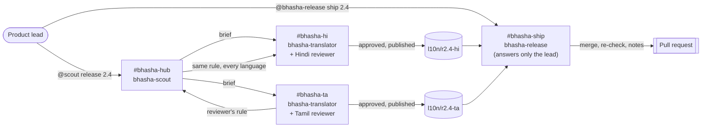

# Bhasha Desk

**Agents translate every release of your app into Indian languages. Native-speaking teammates review, correct and approve in Slack. A release agent opens the pull request only when every language is signed off.**

Built with [Switch](https://github.com/sandbox-quantum/switch) for the Flip the Switch hackathon (Track 01: Best Business Workflow), for Switch Console 0.40.1 with switch-core 0.31.0.

<!-- DEMO-VIDEO: link and GIF go here once recorded -->

---

## The problem

India has 22 scheduled languages, and most people read their own language far more comfortably than English, yet most apps ship English first. Translation is where releases stall: strings go out in spreadsheets and DMs, the people who can judge a translation (support, ops and marketing colleagues who speak the language) aren't in the developer workflow, and machine translation breaks things quietly: a `{amount}` placeholder disappears, a button overflows, a brand name gets translated, and nobody who reads the language ever saw it.

## What Bhasha Desk does



1. The product lead asks **bhasha-scout** in `#bhasha-hub` to start release 2.4. It opens the release branch, posts one banner for the release, and visits each language room to brief the translator.
2. In `#bhasha-hi` and `#bhasha-ta`, **bhasha-translator** drafts the new strings in that room's language. Every draft has already passed `bhasha check` (placeholders, tags, length limits, script, English left behind, glossary rules) before a person sees it.
3. The **native-speaking reviewer** in each room replies in the thread: "approve", or a correction. A correction that is really a rule ("keep *AutoPay* in English, it's our product name") becomes a **glossary decision**: the scout records it once with who decided it and where, and every other language picks it up. The checker then enforces it everywhere, so one person's correction fixes every language.
4. When the reviewer approves, the translator records the approval and publishes the language branch. Recording refuses failing work, and work that hasn't picked up the latest glossary decisions.
5. The lead tells **bhasha-release** in `#bhasha-ship` to ship. It merges only approved languages, re-runs every check on the merged result, writes release notes naming each reviewer and every glossary decision, and opens the pull request.

**The artifact:** a pull request with reviewed locale files, approval records with the reviewer's name, and the glossary decisions behind them.

## Why it needs Switch

The people who can judge a Hindi or Tamil translation aren't developers. They live in chat, not in a terminal. Switch is what puts three agents and those people in the same rooms with shared rules. Remove it and Bhasha Desk becomes three CLI sessions on one laptop, a spreadsheet, and forty DMs.

| Switch feature | How Bhasha Desk uses it |
|---|---|
| **A template** (`switch/bhasha-desk.template.yaml`) | One import creates the three agents, four rooms, links both ways, aliases, kickoffs and an exclusive role. |
| **Room instructions as bindings** | One translator agent serves every language: the language, script, tone and reviewer come from the room's instructions. Adding a language is adding a room, not an agent. |
| **Agents creating rooms** | "@scout add Bengali, reviewer Riya" makes `#bhasha-bn`, writes its instructions, adds the translator and the reviewer, and links it to the hub. |
| **Linked rooms, hub and work rooms** | The hub holds one banner per release; work happens in language rooms; the scout makes round trips and comes home. |
| **Addressing policies** | The translator takes instructions from anyone in its rooms (reviewers aren't Switch users). The scout takes them from the lead and the lead's agents. **bhasha-release answers only the lead**: a reviewer saying "ship it" is refused, visibly. |
| **Approvals in chat** | `auto_approve` is off. Publishing a branch is a person's approval in the room, and Switch records who answered. |
| **Exclusive role** | `release-captain` in `#bhasha-ship`: one holder at a time. |
| **Follow the conversation** | Reviewers reply in the thread without @-mentioning anything. |
| **Agents talking to agents** | The translator hands a reviewer's rule to the scout in the hub; the scout hands it to every other language room. |

## The agents

| Agent | Runs on | Job | Who can instruct it |
|---|---|---|---|
| `bhasha-scout` | Claude Code | Opens releases, briefs language rooms, records glossary decisions, adds languages | the lead and the lead's agents |
| `bhasha-translator` | Claude Code | Translates in whichever language room it's addressed in, one git worktree per language | anyone in its rooms |
| `bhasha-release` | Claude Code | Merges approved languages, re-checks, writes notes, opens the PR | the lead only |

Language models do the language and the conversation. The [`bhasha`](bhasha/) command does everything that must be exactly right, and every agent calls it.

| Command | What it does |
|---|---|
| `bhasha status` / `brief <lang>` | What each language still needs, with English, context, length limits and glossary rules |
| `bhasha apply <lang> -` | Writes translations (JSON on stdin), commits, prints the check |
| `bhasha check [<lang>]` | Placeholders, tags, length (counted the way a reader sees Indian scripts), script, English left behind, glossary keep/prefer/avoid rules |
| `bhasha glossary add` | Records a decision with who decided it, where, and when (current truth plus an append-only log) |
| `bhasha release start/lang/sync/approve/status/merge` | The release workflow, one worktree per language so parallel sessions never collide |

## Run it in 10 minutes

You need macOS, [Switch Console 0.40.1](https://github.com/sandbox-quantum/switch/releases/tag/switch-console-v0.40.1), Docker Desktop (for the bundled Mattermost), [uv](https://docs.astral.sh/uv/), and Claude Code signed in. To use Codex or OpenCode instead, change `provider: claude` in the template.

1. **Give the agents a repository to push to.** Fork this repo, or skip GitHub entirely with a local remote:
   ```bash
   git clone --bare https://github.com/YashSoni998265/bhasha-desk ~/bhasha-remote.git
   # use file:///Users/<you>/bhasha-remote.git as the repository below
   ```
2. **Optional, no Switch needed:** see the deterministic half work.
   ```bash
   git clone https://github.com/YashSoni998265/bhasha-desk && cd bhasha-desk
   uv run --group dev pytest        # 21 tests: every rule in both directions, plus the full release flow in git
   uv run bhasha status             # Hindi and Tamil are each 10 strings behind for release 2.4
   uv run bhasha serve              # the PaySathi app at http://127.0.0.1:8080
   ```
3. **Start Switch:** in Switch Console, choose **Add a server** → **Run a server on this computer**, and open the bundled Mattermost.
4. **Create the desk:** in **Templates**, import `switch/bhasha-desk.template.yaml` and use it:
   - **Repository:** your fork or bare repo
   - **Messaging app:** Mattermost or your Slack
   - **Reviewers:** their names
   - **Name prefix:** `bhasha`, or another prefix for a trial run, since every agent and room name starts with it
5. In `#bhasha-hub`, the kickoff wakes the scout, which posts each language's status. Then type `@scout release 2.4` and follow the briefs into `#bhasha-hi` and `#bhasha-ta`.
6. Review as the reviewer: correct one string, set one rule, and type `approve`.
7. In `#bhasha-ship`, type `@bhasha-release ship 2.4`.

## For judges

<!-- FOR-JUDGES: fill after the live run: timings, what to look at, links to the PR and the room screenshots -->

## Safety model

- **A person decides each language.** Drafts reach a reviewer only after passing every deterministic check, and nothing ships without that reviewer's approval.
- **Approvals can't go stale.** Recording an approval refuses failing work, and refuses work that hasn't picked up glossary decisions published since. The release status judges every language against the release branch's current glossary, so a new rule invalidates an old approval at once.
- **Only the lead ships.** `bhasha-release` answers only its owner, holds an exclusive role, and re-runs every check after merging. If anything fails, it pushes nothing.
- **Publishing needs a person's approval.** `auto_approve` is off for every agent.
- **The glossary has one writer.** Only the scout records decisions, on the release branch. There's one canonical copy and no merge conflicts, and every rule says who decided it and where.

## Limits

<!-- LIMITS: fill after the live run with anything we hit -->

- **The length check approximates what a reader sees.** It counts letters and ignores combining marks (vowel signs, viramas) without rendering fonts.
- **The demo app is fictional,** and its strings are a sample.
- **Pull requests need GitHub and `gh`.** With a local remote, the release agent posts the notes instead.

## Built with

- [Switch](https://github.com/sandbox-quantum/switch): rooms, agents, approvals, templates
- Claude Code: all three agents
- Python standard library: the `bhasha` command, with no runtime dependencies
- Plain HTML and JavaScript: the PaySathi demo app

<!-- WISPR: built-by-voice section with the usage card -->

## AI assistance

The code, prompts and docs were written with Claude Code. We reviewed, tested and can explain all of it.

## Team

- Yash Soni ([@YashSoni998265](https://github.com/YashSoni998265))
- Rohan Jaiswal ([@Sonicof](https://github.com/Sonicof))
