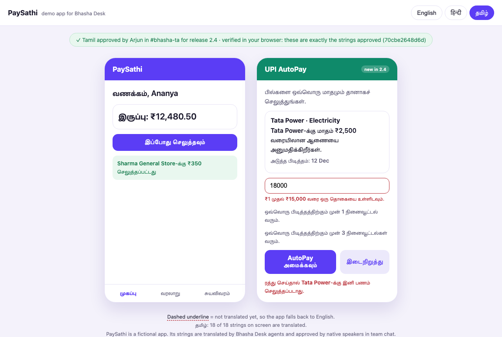
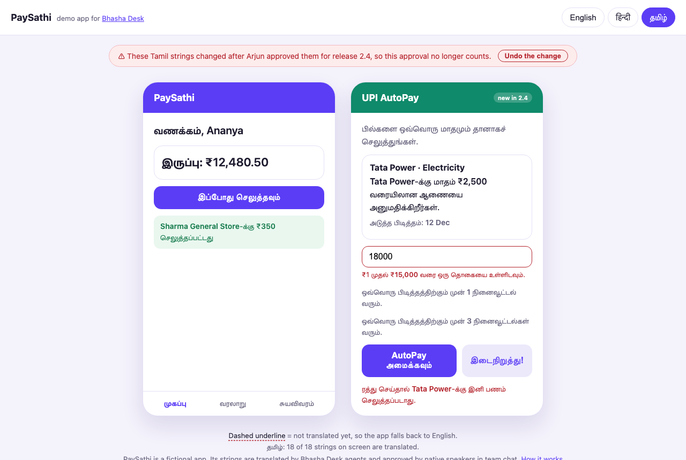
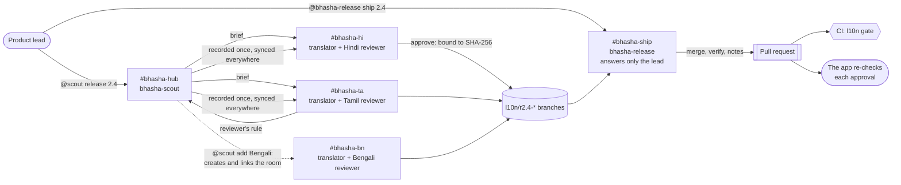

# Bhasha Desk

[](https://github.com/YashSoni998265/bhasha-desk/actions/workflows/ci.yml)
[](LICENSE)


**Ship every release in Indian languages. Agents translate, native-speaking teammates approve in Slack, and nothing ships until every approval matches the exact strings the reviewer saw. CI checks that again on the pull request, and the app checks it again in the user's browser.**

Release 2.4 of PaySathi, a demo payments app, adds 10 strings for UPI AutoPay. One message in Slack starts the release. Three Claude Code agents brief one room per language. Every draft passes 9 deterministic checks before a person sees it. One reviewer's correction becomes a rule that every language follows. A language can be added mid-release with one sentence. The output is a single pull request with each language's reviewer, the room they approved in, and a SHA-256 of what they approved.
<!-- FILL after the real run: "In our run, release 2.4 went from 'release opened' to a verified pull request in N minutes, with K reviewer corrections." -->

| | |
|---|---|
| **Try it in 7 seconds, no Switch needed** | `uv run bhasha demo run` replays a whole release and shows every gate firing ([what it prints](#judge-this-in-5-minutes)) |
| **The Switch template** | [`switch/bhasha-desk.template.yaml`](switch/bhasha-desk.template.yaml): 3 agents, 4 rooms, 6 links, an exclusive role and 4 kickoffs in one import |
| **Design notes** | [`docs/ARCHITECTURE.md`](docs/ARCHITECTURE.md): records, the approval-integrity spec, the release gate, CI |
| **Hackathon** | Flip the Switch (WeMakeDevs × Switch) · Track 01: Best Business Workflow |
<!-- FILL: | **Demo video (3 min)** | https://youtu.be/… · the correction fixing every language at m:ss · the gate holding at m:ss | -->
<!-- FILL: | **Live app** | https://yashsoni998265.github.io/bhasha-desk/?lang=ta · press "Try it: change one word" | -->
<!-- FILL: | **The release pull request** | https://github.com/YashSoni998265/bhasha-desk/pull/N · green `l10n gate` | -->
<!-- FILL: | **Blog** | https://… | -->

| After a release ships, the app names each language's approver and re-checks the digest in your browser | Change one word after approval and the app says the approval no longer counts |
|---|---|
|  |  |

<sub>Screenshots from `bhasha demo run --serve`; the reviewers' names are examples.</sub>

---

## Judge this in 5 minutes

<!-- FILL: 0. Watch the 3-minute video (link above). The key moments: m:ss and m:ss. -->

1. **Replay a release without Switch** (needs git and [uv](https://docs.astral.sh/uv/)):
   ```bash
   git clone https://github.com/YashSoni998265/bhasha-desk && cd bhasha-desk
   uv run bhasha demo run --serve
   ```
   In about 7 seconds you see the scout open release 2.4, and drafts in Tamil and Hindi. A Tamil reviewer's rule is recorded once, and **the check flags the strings that break it in both languages**. Then come the approvals bound to SHA-256 digests. **The release agent refuses to ship** after a string changes post-approval. **CI passes on a clean clone and fails** when an approved string is edited. The shipped app then opens at http://127.0.0.1:8080/?lang=ta. Press **Try it: change one word**.
2. **Read the template.** [`switch/bhasha-desk.template.yaml`](switch/bhasha-desk.template.yaml) is the project. Look for:
   - the three addressing policies (`owner`, `owner-agents`, `anyone`)
   - room instructions that bind each room to its language
   - the hub's `language:` links, which are the language registry
   - the exclusive `release-captain` role
   - kickoffs where every agent says what it will never do
3. **Check the gate's code.** `verify_tree` in [`bhasha/release.py`](bhasha/release.py) and [`bhasha/integrity.py`](bhasha/integrity.py). The tests in [`tests/`](tests/) play the whole flow in git, both ways.
4. **Look at CI.** [The `ci` workflow](.github/workflows/ci.yml) runs the tests on Python 3.9 and 3.13, plus the `l10n gate`. On a release pull request that gate is `bhasha release verify`.
<!-- FILL: 5. Open the real release pull request: the notes table, the timeline, and Checks → l10n gate → Summary. -->

## How we meet the brief

| Criterion | What Bhasha Desk does | Where to see it |
|---|---|---|
| **Use of Switch (30%)**: is Switch central, and would it stop working without it? | Three agents with separate jobs and separate addressing policies. Four rooms whose instructions bind one translator to each language, linked into one group, with the hub's links as the language registry. Agents carry rules across rooms (`connect_to_room`, `send_targeted_message`) and create and link a new language room at runtime (`create_room`, `link_rooms`). An exclusive `release-captain` role. Auto mode with `auto_approve` off, so pushes and the PR wait for a person's Allow in the room. Remove Switch and the reviewers, the approvals and the hand-offs have nowhere to live. | [the template](switch/bhasha-desk.template.yaml) · [Why it needs Switch](#why-it-needs-switch) |
| **Technical execution (25%)**: does it run, and can someone reproduce it? | One import builds the desk, and the template lints clean with Switch's own linter. `bhasha doctor` preflights every run. 42 tests, CI on two Python versions. `bhasha demo run` reproduces the whole flow on any machine with git and uv, without Switch. | [CI](https://github.com/YashSoni998265/bhasha-desk/actions/workflows/ci.yml) · [tests](tests/) · [setup](#run-it-with-switch-in-10-minutes) |
| **Creativity and impact (25%)**: a fresh idea a real team needs? | Localization is a people problem: the colleagues who can judge Tamil or Hindi aren't developers. Bhasha Desk brings them into the release in chat. One reviewer's correction becomes a rule every language follows, and no string can change quietly after its approval, not even after the merge, because the app re-checks it. | [The problem](#the-problem) · [Enterprise-grade controls](#enterprise-grade-controls) |
| **Presentation (20%)**: do the video and README make Switch's role clear? | This README, the design notes, screenshots of every state, and a 3-minute video of real teammates in Slack. | [docs/ARCHITECTURE.md](docs/ARCHITECTURE.md) |

## The problem

India has 22 scheduled languages. In 2024, 98% of its 886 million active internet users went online in Indian languages ([IAMAI–Kantar, *Internet in India 2024*](https://www.business-standard.com/industry/news/india-to-exceed-900mn-internet-users-by-2025-125011600669_1.html)). Yet most apps still ship English first, and translation is where releases stall:
- **Strings go out in spreadsheets and DMs**, and come back late.
- **The people who can judge a translation aren't in the developer workflow.** Support, ops and marketing colleagues speak the language; they don't use git.
- **Machine translation breaks things quietly.** A `{merchant}` placeholder disappears, a button overflows, a brand name gets translated, and nobody who reads the language ever saw it.

In payments this is about consent, not polish. RBI's e-mandate rules require a notification at least 24 hours before every AutoPay debit, and debits above ₹15,000 need extra authentication ([Business Today](https://www.businesstoday.in/personal-finance/news/story/rbi-caps-recurring-payments-at-rs15000-without-otp-under-new-e-mandate-framework-526759-2026-04-21), [Outlook Money](https://www.outlookmoney.com/amp/story/personal-finance/rbi-issues-digital-payments-e-mandate-framework-to-simplify-and-secure-recurring-transactions)). PaySathi's AutoPay screen carries exactly those strings: the mandate's limit, the next debit, the reminders. A user who can't read them in their own language can't really agree to them.

## How it works



1. **Open.** The lead asks **bhasha-scout** in `#bhasha-hub` to start release 2.4. It runs a preflight and opens the release branch with a manifest: who asked, when, and from which commit. It posts one banner for the release and briefs every room the hub links as a language.
2. **Draft.** In each language room, **bhasha-translator** drafts the new strings in that room's language, script and tone. Every draft has already passed `bhasha check` before a person sees it: placeholders, tags, length, script, English left behind, glossary rules and consistency.
3. **Decide.** The native-speaking reviewer replies in the thread: `approve`, or a correction. A correction that is really a rule ("keep *AutoPay* in English, it's our product name") goes to the scout, which records it once with who decided it and where. Then the scout asks **every** language room to sync. In each room the check points at exactly the strings that break the rule, so one person's correction fixes every language.
4. **Approve.** Recording an approval refuses failing work, and work that hasn't synced the latest decisions. The record holds SHA-256 digests of the strings and of the English they translate. Change either afterwards and the approval no longer counts.
5. **Ship.** The lead tells **bhasha-release** in `#bhasha-ship` to ship. It merges only languages with a current approval, then verifies the merged result: every string, every check, every digest. It writes release notes with a timeline and opens the pull request. CI runs the same gate on the PR. After the merge, the app re-checks each approval in the user's browser.

**The artifact** is one pull request containing:
- the reviewed locale files
- `RELEASE.json` (who opened the release, when, from which commit)
- one approval record per language: reviewer, room, time and digests
- the glossary decisions, each saying who decided it
- `approvals.json` for the app
- release notes with a timeline from "release opened" to "pull request"
- a green `l10n gate`

## Why it needs Switch

The people who can judge a Hindi or Tamil translation aren't developers, and they live in chat. Switch puts three agents and those people in the same rooms, under shared rules.

Remove Switch and nothing connects. The reviewer's "approve" has nowhere to be said. The rule decided in `#bhasha-ta` has no path to `#bhasha-hi`. Nothing stops a reviewer from shipping. What's left is three CLI sessions on one laptop, a spreadsheet and forty DMs.

| Switch feature | How Bhasha Desk uses it |
|---|---|
| **One template** | One import creates 3 agents, 4 rooms in a group, 6 links, aliases, an exclusive role, and kickoffs in which every agent states what it will never do. |
| **Room instructions as bindings** | One translator agent serves every language. The language, script, tone and reviewer come from the room it's in. |
| **Linked rooms as a registry** | The scout briefs whichever rooms the hub links as `language: <Language>`, found with `list_linked_rooms`. |
| **Agents creating rooms** | `@scout add Bengali, reviewer Riya` calls `create_room` (bridge, group, alias, instructions, link back) and `link_rooms`. Bengali joins the open release and must be approved before it ships. |
| **Agents talking to agents across rooms** | The translator carries a reviewer's rule to the scout in the hub, and the scout carries it to every language room (`connect_to_room`, `send_targeted_message`). |
| **Addressing policies** | The translator takes instructions from anyone in its rooms, because reviewers aren't Switch users. The scout takes them from the lead and the lead's agents. **bhasha-release answers only the lead**: a reviewer saying "ship it" is refused by Switch itself. |
| **Auto mode, approvals in chat** | `auto_approve` is off and auto mode lets safe steps run. Pushing a branch and opening the PR wait for a person to press **Allow** in the room. |
| **Exclusive role** | One agent at a time can hold `release-captain` in `#bhasha-ship` (`!roles` shows who). |
| **Threads, follow-ups, `!assign-agent`** | Each release has one banner, with updates in its thread. Reviewers reply in the drafts thread, and with `!assign-agent` they never have to @-mention a bot. |

## Enterprise-grade controls

| Control | How |
|---|---|
| **Approvals you can verify** | Each approval stores SHA-256 digests of the language's strings and of the English (with context and limits) it translates. `release status` shows a stale approval, `merge` refuses it, and CI fails it. [The spec](docs/ARCHITECTURE.md#approval-integrity). |
| **Verified where people read it** | The app reads the published approvals, recomputes the digest of what it shows with WebCrypto, and shows "✓ approved by … verified in your browser", or a warning. A test runs the app's own digest code under Node and checks it matches the CLI byte for byte. |
| **A release gate in CI** | On the release PR, every shipped language must be fully translated, pass every check and carry a current approval. It runs on the merge with `main`, so an English change that lands after an approval is caught too. |
| **Separation of duties** | The translator drafts and never approves. A native speaker approves. Only the lead ships, a rule Switch enforces. Pushes and the PR need a person's Allow, and only one agent can hold release-captain. |
| **Audit trail in git** | The manifest, the approval records (who, where, when, what), a glossary with an append-only log and provenance, and release notes with a timeline. |
| **Checks a language model can't skip** | Placeholders, tags, length counted the way Indian scripts render, script mixing, English left behind, keep/prefer/avoid glossary rules, and consistency. |
| **Preflight** | `bhasha doctor` checks data files, remote reachability, GitHub login and commit identity. The scout runs it at kickoff, so a problem shows up as one line in chat instead of a failed push mid-release. |
| **Parallel work without collisions** | One git worktree per language, one writer for the glossary, and retries on git lock contention. |
| **Supply chain** | No runtime dependencies (standard library only). CI actions are pinned by commit SHA. |

## Security model

- **Who can make an agent act.** The release agent obeys only the lead, and Switch enforces that before the model sees the message. The scout obeys the lead and the lead's agents. The translator is open to anyone in its rooms, because reviewers aren't Switch users. So on its own it can't push, open a pull request or ship: pushes and pull requests need a person's Allow, and shipping belongs to the release agent.
- **Prompt injection in a language room** can at most get a draft changed. The change must pass every check, and it voids any approval it touches. An approval counts only from the room's named reviewer, never from an agent, and is recorded with the approver's name and room. CI verifies the digests on the PR, and the browser re-verifies them after merge.
- **What an approval proves.** It proves who approved what as far as the chat identity goes. It isn't signed by the reviewer: the Switch room's history is the evidence.
- **Least privilege.** Agents push with the deployer's local git credentials. For a production desk, give each agent a Switch GitHub connection scoped to this one repository (`connections: [{service: github, access: write, repos: [owner/bhasha-desk]}]`). We left it out so the template runs for anyone without a GitHub connection set up.
- **No secrets in the repo.** Agent credentials (`.switch/`) are ignored, and nothing reads keys from the environment.

## The agents and the tool

| Agent | Runs on | Job | Who can instruct it |
|---|---|---|---|
| `bhasha-scout` | Claude Code | Opens releases, briefs language rooms, records glossary decisions, adds languages | the lead and the lead's agents |
| `bhasha-translator` | Claude Code | Translates in whichever language room it's addressed in, in one worktree per language | anyone in its rooms |
| `bhasha-release` | Claude Code | Merges approved languages, verifies, writes notes, opens the PR, reports CI | the lead only |

Language models do the language and the conversation. The [`bhasha`](bhasha/) command does everything that must be exactly right, and every agent calls it.

| Command | What it does |
|---|---|
| `bhasha doctor` | Preflight: data files, remote, `gh` login, identity |
| `bhasha status` / `brief <lang>` | What each language still needs, with English, context, length limits and glossary rules |
| `bhasha apply <lang> -` | Writes translations (JSON on stdin), commits, prints the check, and warns when an edit voids an approval |
| `bhasha check [<lang>]` | Every deterministic check (`--allow-missing` for work in progress) |
| `bhasha glossary add` | Records a decision with who decided it, where and when |
| `bhasha release start / lang / sync / approve / status / merge` | The release workflow |
| `bhasha release verify <release>` | The release gate |
| `bhasha ci` | What CI runs: the release gate on `l10n/r<release>`, health checks everywhere else |
| `bhasha demo run [--serve]` | A whole release replayed in seconds, without Switch |

## Run it with Switch in 10 minutes

You need:
- macOS
- [Switch Console 0.40.1](https://github.com/sandbox-quantum/switch/releases/tag/switch-console-v0.40.1)
- Docker Desktop, for the bundled Mattermost
- [uv](https://docs.astral.sh/uv/)
- Claude Code, signed in. To use Codex or OpenCode instead, change `provider: claude` in the template.

1. **Give the agents a repository to push to.** Fork this repo (CI comes with it), or skip GitHub entirely with a local remote:
   ```bash
   git clone --bare https://github.com/YashSoni998265/bhasha-desk ~/bhasha-remote.git
   # use file:///Users/<you>/bhasha-remote.git as the repository below
   ```
2. **Start Switch:** in Switch Console, choose **Add a server** → **Run a server on this computer**, and open the bundled Mattermost.
3. **Create the desk:** in **Templates**, import `switch/bhasha-desk.template.yaml` and use it:
   - **Repository:** your fork or bare repo
   - **Messaging app:** Mattermost or your Slack
   - **Reviewers:** their names
   - **Name prefix:** `bhasha`, or another prefix for a trial run, since every agent and room name starts with it

   Switch checks the whole run before creating anything. If your setup differs, every card says why (for example `provider_login_missing`), and nothing is created.
4. **Introductions.** Every room's kickoff makes its agent introduce itself and say what it will never do. In `#bhasha-hub` the scout also runs the preflight and posts where each language stands.
5. **Optional, but kind to reviewers:** in each language room, type `!assign-agent @bhasha-translator`.
6. Type `@scout release 2.4` in `#bhasha-hub`, and follow the briefs into `#bhasha-hi` and `#bhasha-ta`.
7. Review as the reviewer: correct one string, set one rule, and type `approve`. Optionally, `@scout add Bengali, reviewer <you>`.
8. In `#bhasha-ship`, type `@bhasha-release ship 2.4`.

`!agents-status` in any room shows whether an agent is live, working, or waiting for someone to press Allow.

## Limits

- **An approval is as trustworthy as the chat identity behind it.** See the [security model](#security-model).
- **The length check approximates what a reader sees.** It counts letters and ignores combining marks (vowel signs, viramas) without rendering fonts.
- **The demo app is fictional,** and its strings are a sample.
- **Pull requests need GitHub and `gh`.** With a local remote, the release agent posts the notes instead, and the gate runs locally (`bhasha release verify`).
- **Agents run on the machine that runs Switch Console.** A desk the whole team relies on belongs on an always-on host, which Switch supports with remote machines.
<!-- FILL: anything we hit in the live run -->

## Built with

- [Switch](https://github.com/sandbox-quantum/switch): rooms, agents, approvals, templates
- Claude Code: all three agents
- Python standard library: the `bhasha` command, with no runtime dependencies
- GitHub Actions: tests and the l10n gate
- Plain HTML and JavaScript: the PaySathi demo app, with WebCrypto for the in-browser check

<!-- WISPR: built-by-voice section with the usage card -->

## AI assistance

The code, prompts and docs were written with Claude Code. We reviewed and tested all of it, and can explain every part.

## Team and license

- Yash Soni ([@YashSoni998265](https://github.com/YashSoni998265))
- Rohan Jaiswal ([@Sonicof](https://github.com/Sonicof))

[MIT](LICENSE)
