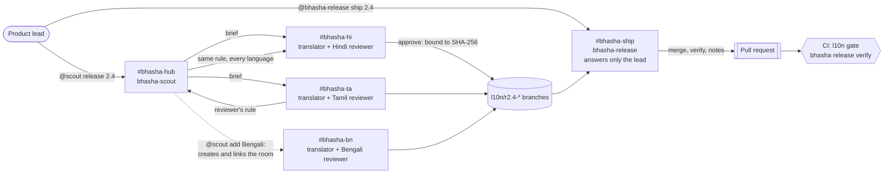

# Bhasha Desk

[](https://github.com/YashSoni998265/bhasha-desk/actions/workflows/ci.yml)

**Agents translate every release of your app into Indian languages. Native-speaking teammates review, correct and approve in Slack. A release agent ships one pull request, and only when every language is signed off. Each approval is bound to the exact strings the reviewer saw, and CI checks that again.**

Built with [Switch](https://github.com/sandbox-quantum/switch) for the Flip the Switch hackathon (Track 01: Best Business Workflow), on Switch Console 0.40.1 with switch-core 0.31.0.

<!-- DEMO-VIDEO: link and GIF go here once recorded -->

**In 30 seconds**

1. `@scout release 2.4` in `#bhasha-hub`. Agents brief every language room and draft the new strings, which pass a deterministic checker before any person sees them.
2. A Tamil reviewer replies "AutoPay is our product name, keep it in English". That becomes a glossary rule with their name on it, and **every other language fixes itself**.
3. Each reviewer types `approve`. The approval is recorded with a SHA-256 of the exact strings it covers.
4. `@bhasha-release ship 2.4` in `#bhasha-ship`, a command only the lead can give. It merges, verifies and opens a pull request with an audit trail. **CI re-verifies every approval** on the PR.
5. `@scout add Bengali, reviewer Riya`: the scout creates `#bhasha-bn`, links it into the desk, and Bengali joins the release.

| After a release ships, the app names each language's approver and re-checks the digest in the browser | Change one string after approval and the app says so |
|---|---|
|  |  |

<sub>Screenshots from a simulated run of the release flow; the names are examples.</sub>

---

## The problem

India has 22 scheduled languages, and back in 2016 it already had more internet users who prefer an Indian language (234 million) than English (175 million) ([KPMG and Google, 2017](https://kpmg.com/ky/en/home/insights_new/2017/04/indian-language-internet-users.html)). Yet most apps ship English first. Translation is where releases stall:
- Strings go out in spreadsheets and DMs.
- The people who can judge a translation aren't in the developer workflow: support, ops and marketing colleagues who speak the language.
- Machine translation breaks things quietly. A `{amount}` placeholder disappears, a button overflows, a brand name gets translated, and nobody who reads the language ever saw it.

In a payments app those mistakes cost money and trust.

## How it works



1. **Open.** The lead asks **bhasha-scout** in `#bhasha-hub` to start release 2.4. It runs a preflight (`bhasha doctor`) and opens the release branch with a manifest recording who asked, when and from which commit. It then posts one banner for the release and briefs every language room.
2. **Draft.** In each language room, **bhasha-translator** drafts the new strings in that room's language, script and tone. Every draft has already passed `bhasha check` (placeholders, tags, length, script, English left behind, glossary rules) before a person sees it.
3. **Decide.** The **native-speaking reviewer** replies in the thread: `approve`, or a correction. A correction that is really a rule becomes a **glossary decision**. The scout records it once with who decided it and where, and every other language syncs it. The checker then enforces it everywhere.
4. **Approve.** Recording an approval refuses failing work and work that hasn't synced the latest decisions. The record holds SHA-256 digests of the strings and of the English they translate. Change either afterwards and the approval no longer counts.
5. **Ship.** The lead tells **bhasha-release** in `#bhasha-ship` to ship. It merges only languages with a current approval and verifies the merged result: every string, every check, every digest. It then writes the release notes and opens the pull request. CI runs the same gate on the PR, so a translation edited after approval can't merge.

**The artifact** is one pull request containing:
- the reviewed locale files
- a manifest, plus one approval record per language: reviewer, room, time and digests
- the glossary decisions with provenance
- release notes with a timeline from "release opened" to "pull request", the lead time
- `demo-app/locales/approvals.json`, which the app uses to name each language's approver and verify the strings in the browser
- a green `l10n gate` check

## Why it needs Switch

The people who can judge a Hindi or Tamil translation aren't developers, and they live in chat. Switch puts three agents and those people in the same rooms, under shared rules. Without it, Bhasha Desk becomes three CLI sessions on one laptop, a spreadsheet and forty DMs.

| Switch feature | How Bhasha Desk uses it |
|---|---|
| **One template** ([`switch/bhasha-desk.template.yaml`](switch/bhasha-desk.template.yaml)) | One import creates 3 agents, 4 rooms in a group, 6 links, aliases, kickoffs and an exclusive role. It lints clean with switch-core 0.31.0's own linter, and CI lints it too. |
| **Room instructions as bindings** | One translator agent serves every language. The language, script, tone and reviewer come from the room it's in. |
| **Linked rooms as a registry** | The scout briefs whichever rooms the hub links as `language: <Language>`. Adding a language means adding one room and one link. |
| **Agents creating rooms** | `@scout add Bengali, reviewer Riya` calls `create_room` (bridge, group, aliases, instructions, link back) and then `link_rooms`. Bengali becomes part of the open release and must be approved before it ships. |
| **Agents talking to agents across rooms** | The translator carries a reviewer's rule to the scout in the hub, and the scout carries it to every other language room (`connect_to_room`, `send_targeted_message`). |
| **Addressing policies** | The translator takes instructions from anyone in its rooms, because reviewers aren't Switch users. The scout takes them from the lead and the lead's agents. **bhasha-release answers only the lead**: a reviewer saying "ship it" is refused, visibly. |
| **Auto mode with approvals in chat** | `auto_approve` is off, and auto mode lets safe steps run. Pushing a branch and opening the pull request wait for a person to press **Allow** in the room. |
| **Exclusive role** | `release-captain` in `#bhasha-ship` has one holder at a time (`!roles` shows who). |
| **Threads and follow-ups** | Each release has one banner, with updates in its thread. Reviewers reply in the drafts thread without @-mentioning anything. |

## Enterprise-grade controls

| Control | How |
|---|---|
| **Approvals you can verify** | Each approval stores `sha256` digests of the language's strings and of the English (with context and limits) it translates. `release status` shows a stale approval, `merge` refuses it, and CI fails it. See [the spec](docs/ARCHITECTURE.md#approval-integrity). |
| **Verified where people read it** | The app loads the approvals summary, recomputes the SHA-256 of the strings it displays with WebCrypto, and shows "✓ Tamil approved by … verified in your browser", or a warning if the strings changed after approval. A test keeps the browser's canonical JSON byte-identical to the CLI's. |
| **A release gate in CI** | The workflow runs `bhasha ci`. On the release PR, every shipped language must be fully translated, pass every check and carry a current approval. It runs on the merge with `main`, so an English change that lands after an approval is caught too. |
| **Separation of duties** | The translator drafts, a native speaker approves, and only the lead ships. Pushes and the PR need a person's Allow, and only one agent can hold release-captain. |
| **Audit trail in git** | `RELEASE.json` records who opened the release, when and from which commit. Each approval file records who, where, when and what. The glossary keeps its current rules plus an append-only log with provenance. The release notes have a timeline. |
| **Checks a language model can't skip** | Placeholders, tags, length counted the way Indian scripts render, script mixing, English left behind, keep/prefer/avoid glossary rules, and consistency. |
| **Preflight** | `bhasha doctor` checks data files, remote reachability, GitHub login and commit identity. The scout runs it at kickoff, so problems show up as one line in chat instead of a failed push mid-release. |
| **Parallel work without collisions** | Each language works in its own git worktree, the glossary has a single writer, and git lock contention is retried. |
| **Supply chain** | No runtime dependencies (standard library only). CI actions are pinned by commit SHA. Tests run on Python 3.9 and 3.13. |

## The agents and the tool

| Agent | Runs on | Job | Who can instruct it |
|---|---|---|---|
| `bhasha-scout` | Claude Code | Opens releases, briefs language rooms, records glossary decisions, adds languages | the lead and the lead's agents |
| `bhasha-translator` | Claude Code | Translates in whichever language room it's addressed in, in one worktree per language | anyone in its rooms |
| `bhasha-release` | Claude Code | Merges approved languages, verifies, writes notes, opens the PR, reports CI | the lead only |

Language models do the language and the conversation. The [`bhasha`](bhasha/) command does everything that must be exactly right, and every agent calls it.

| Command | What it does |
|---|---|
| `bhasha doctor` | Preflight: data files, remote, `gh` login, identity |
| `bhasha status` / `brief <lang>` | What each language still needs, with English, context, length limits and glossary rules |
| `bhasha apply <lang> -` | Writes translations (JSON on stdin), commits, prints the check, and warns when an edit voids an approval |
| `bhasha check [<lang>]` | Every deterministic check (`--allow-missing` for work in progress) |
| `bhasha glossary add` | Records a decision with who decided it, where and when |
| `bhasha release start / lang / sync / approve / status / merge` | The release workflow |
| `bhasha release verify <release>` | The release gate |
| `bhasha ci` | What CI runs: the release gate on `l10n/r<release>`, health checks elsewhere |

## Run it in 10 minutes

You need:
- macOS
- [Switch Console 0.40.1](https://github.com/sandbox-quantum/switch/releases/tag/switch-console-v0.40.1)
- Docker Desktop, for the bundled Mattermost
- [uv](https://docs.astral.sh/uv/)
- Claude Code, signed in. To use Codex or OpenCode instead, change `provider: claude` in the template.

1. **Give the agents a repository to push to.** Fork this repo (its CI comes with it), or skip GitHub entirely with a local remote:
   ```bash
   git clone --bare https://github.com/YashSoni998265/bhasha-desk ~/bhasha-remote.git
   # use file:///Users/<you>/bhasha-remote.git as the repository below
   ```
2. **Optional, no Switch needed:** see the deterministic half work.
   ```bash
   git clone https://github.com/YashSoni998265/bhasha-desk && cd bhasha-desk
   uv run --group dev pytest        # 39 tests: every rule both ways, the full release flow in git, the CI gate, the template, browser/CLI digest parity
   uv run bhasha doctor             # preflight
   uv run bhasha status             # Hindi and Tamil are each 10 strings behind for release 2.4
   uv run bhasha serve              # the PaySathi app at http://127.0.0.1:8080
   ```
3. **Start Switch:** in Switch Console, choose **Add a server** → **Run a server on this computer**, and open the bundled Mattermost.
4. **Create the desk:** in **Templates**, import `switch/bhasha-desk.template.yaml` and use it:
   - **Repository:** your fork or bare repo
   - **Messaging app:** Mattermost or your Slack
   - **Reviewers:** their names
   - **Name prefix:** `bhasha`, or another prefix for a trial run, since every agent and room name starts with it
5. In `#bhasha-hub`, the kickoff wakes the scout, which runs the preflight and posts each language's status. Then type `@scout release 2.4` and follow the briefs into `#bhasha-hi` and `#bhasha-ta`.
6. Review as the reviewer: correct one string, set one rule, and type `approve`. Optionally `@scout add Bengali, reviewer <you>`.
7. In `#bhasha-ship`, type `@bhasha-release ship 2.4`.

## For judges

<!-- FOR-JUDGES: fill after the live run: the PR link, the CI run, timings, screenshots of the rooms -->

- **The template:** [`switch/bhasha-desk.template.yaml`](switch/bhasha-desk.template.yaml). Everything about the workflow is in there.
- **The gate:** [`bhasha/release.py`](bhasha/release.py) (`verify_tree`) and [`bhasha/integrity.py`](bhasha/integrity.py).
- **The whole flow in git, with no chat:** [`tests/test_release_flow.py`](tests/test_release_flow.py).
- **Design notes:** [`docs/ARCHITECTURE.md`](docs/ARCHITECTURE.md).

## Limits

<!-- LIMITS: add anything we hit in the live run -->

- **An approval is as trustworthy as the chat identity behind it.** The translator records the reviewer named in the room and the room it was given in. The approval isn't signed by the reviewer; the Switch room's history is the evidence.
- **The length check approximates what a reader sees.** It counts letters and ignores combining marks (vowel signs, viramas) without rendering fonts.
- **The demo app is fictional,** and its strings are a sample.
- **Pull requests need GitHub and `gh`.** With a local remote, the release agent posts the notes instead, and the gate runs locally (`bhasha release verify`).

## Built with

- [Switch](https://github.com/sandbox-quantum/switch): rooms, agents, approvals, templates
- Claude Code: all three agents
- Python standard library: the `bhasha` command, with no runtime dependencies
- GitHub Actions: tests and the l10n gate
- Plain HTML and JavaScript: the PaySathi demo app

<!-- WISPR: built-by-voice section with the usage card -->

## AI assistance

The code, prompts and docs were written with Claude Code. We reviewed and tested all of it, and can explain every part.

## Team

- Yash Soni ([@YashSoni998265](https://github.com/YashSoni998265))
- Rohan Jaiswal ([@Sonicof](https://github.com/Sonicof))
